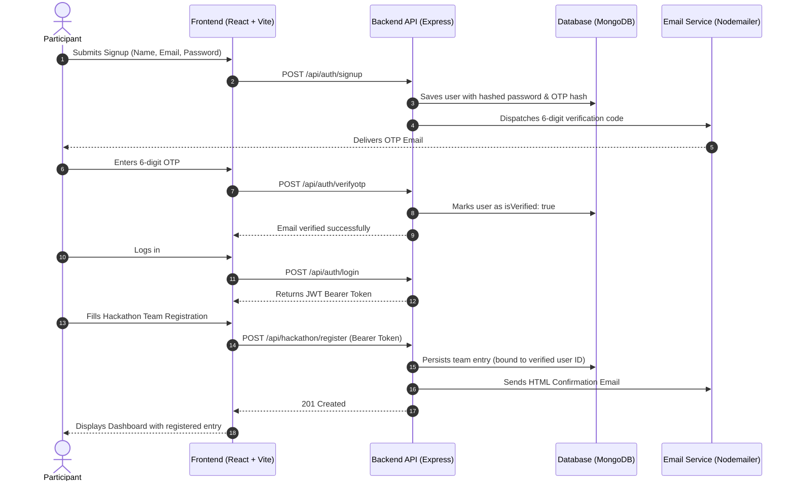

<div align="center">

# 🚀 Code-a-Nova Hackathon Registration Portal

An end-to-end, production-ready MERN platform for managing hackathon team registrations, email verification, submissions, and participant dashboards.

[](https://nodejs.org/)
[](https://expressjs.com/)
[](https://react.dev/)
[](https://vitejs.dev/)
[](https://tailwindcss.com/)
[](https://www.mongodb.com/)
[](https://www.docker.com/)

[Features](#-key-features) • [Architecture](#-architecture--user-flow) • [Project Layout](#-project-directory-structure) • [Quick Start](#-quick-start) • [Environment Variables](#-environment-variables) • [API Reference](#-api-endpoints) • [Deployment](#-deployment-guide)

</div>

---

## 📌 Overview

**Code-a-Nova** provides hackathon organizers and participants with a streamlined, secure experience:
- **Participants** can register solo or with teams of up to 5 members, submit project artifacts (slide decks, working prototype URLs, demo links), and receive automated email receipts.
- **Security** is baked in with 6-digit OTP verification upon account creation, bcrypt password hashing, 7-day JWT session guards, rate-limiting on sensitive endpoints, and server-side request sanitization.

---

## ✨ Key Features

### 🔐 Authentication & Security
- **OTP Verification Flow:** Signups generate a 6-digit cryptographically secure OTP. The OTP hash is stored in MongoDB with a 10-minute TTL, single-use invalidation, and cooldown guards against spamming.
- **Bcrypt & JWT Auth:** Passwords hashed with 10 salt rounds; authenticated routes guarded via `Authorization: Bearer <token>`.
- **DDoS & Brute-Force Prevention:** Global and endpoint-specific rate limiting (`express-rate-limit`) on login and OTP generation.
- **Secure HTTP Headers:** Preconfigured with `helmet` for defense-in-depth against XSS and clickjacking.

### 👥 Team Registration & Submissions
- **Dynamic Team Builder:** Select team size (1 to 5 members). Team size 1 defaults to solo mode; larger team sizes automatically generate input fields for team member names and verified emails.
- **Dual Validation:** Registration forms are validated synchronously on the React client and enforced independently by the Express API.
- **Project Deliverables:** Tracks presentation slide links, GitHub/Figma prototype URLs, and optional video demo links.
- **Automated HTML Emails:** Sends transactional registration confirmations and OTPs via Nodemailer.

### 📊 Dashboard & Self-Service
- **Participant Hub:** Review submitted team details, track selections, and project assets in one place.
- **Entry Withdrawal:** Allows participants to withdraw their submission prior to judging deadlines.
- **Contact Channel:** Built-in contact form forwards participant queries directly to the organizing team's inbox.

---

## 🔄 Architecture & User Flow



---

## 📂 Project Directory Structure

The repository is cleanly decoupled into standalone `backend` and `frontend` packages:

```text
Hackathon-Portal/
├── .gitignore                  # Git ignore rules
├── docker-compose.yml          # Multi-container orchestration (Frontend + Backend)
├── README.md                   # Comprehensive project documentation
│
├── backend/                    # Node.js + Express REST API
│   ├── .env.example            # Environment template for backend
│   ├── Dockerfile              # Production containerfile (Alpine + Node 20)
│   ├── package.json            # Server dependencies & scripts
│   ├── package-lock.json
│   ├── server.js               # Entry point: Express, CORS, Helmet, Mongo connection
│   ├── controllers/            # Request handlers
│   │   ├── authController.js       # Signup, OTP generation, verification, login
│   │   ├── contactController.js    # Contact form submissions & forwarding
│   │   ├── hackathonController.js  # Registration submission, query, withdrawal
│   │   └── userController.js       # Profile management
│   ├── middleware/             # Express middlewares
│   │   ├── auth.js                 # JWT Bearer token verification
│   │   ├── errorHandler.js         # Centralized error responder
│   │   └── rateLimiter.js          # IP request throttling
│   ├── models/                 # Mongoose schemas
│   │   ├── Registration.js         # Team members, project links, domain track
│   │   └── User.js                 # Credentials, OTP hash, verification flags
│   ├── routes/                 # Express API routes
│   │   ├── authRoutes.js           # /api/auth/*
│   │   ├── contactRoutes.js        # /api/contact
│   │   ├── hackathonRoutes.js      # /api/hackathon/*
│   │   └── userRoutes.js           # /api/user/*
│   └── utils/                  # Reusable utilities
│       ├── emailTemplates.js       # HTML markup for OTP and Confirmation emails
│       ├── logger.js               # Structured logger wrapper
│       ├── sendEmail.js            # Nodemailer transport execution
│       └── validateRegistration.js # Strict backend data validation
│
└── frontend/                   # React 18 + Vite SPA
    ├── .env.example            # Environment template for frontend
    ├── Dockerfile              # Multi-stage production containerfile (Vite -> Nginx)
    ├── index.html              # Single page root HTML
    ├── package.json            # Client dependencies & scripts
    ├── package-lock.json
    ├── postcss.config.js       # PostCSS processor config
    ├── tailwind.config.js      # Tailwind CSS styling design system
    ├── vercel.json             # Vercel SPA routing rewrite rules
    ├── vite.config.js          # Vite build tool configuration
    ├── public/                 # Static public assets
    │   ├── favicon.svg
    │   └── _redirects          # Netlify SPA routing rewrite rules
    └── src/
        ├── App.jsx             # React Router route trees
        ├── eventConfig.js      # Event tracks, rules, timeline, prizes & colleges
        ├── main.jsx            # React 18 createRoot bootstrap
        ├── assets/styles/
        │   └── index.css       # Tailwind base, components, and utilities
        ├── components/         # Modular UI components
        │   ├── AuthShell.jsx       # Layout wrapper for auth flows
        │   ├── Field.jsx           # Form input helper with error indicators
        │   ├── Footer.jsx          # Site footer
        │   ├── Logo.jsx            # Brand SVG logo
        │   ├── Navbar.jsx          # Responsive header with mobile hamburger menu
        │   └── ProtectedRoute.jsx  # Route guard requiring valid session
        ├── contexts/
        │   └── AuthContext.jsx     # Global authentication state provider
        ├── pages/              # View screens
        │   ├── About.jsx           # Hackathon guidelines and overview
        │   ├── Contact.jsx         # Support and query form
        │   ├── Dashboard.jsx       # User profile and registered entry review
        │   ├── Home.jsx            # Landing hero, tracks, prizes & timeline
        │   ├── Login.jsx           # User login view
        │   ├── Register.jsx        # Multi-field team registration form
        │   ├── Signup.jsx          # User registration view
        │   └── VerifyOtp.jsx       # 6-digit OTP verification view
        └── services/
            └── api.js              # Axios client configured with JWT interceptors
```

---

## ⚡ Quick Start

### Prerequisites
- **Node.js**: v18.0.0 or higher
- **MongoDB**: A running local MongoDB instance or a free [MongoDB Atlas](https://www.mongodb.com/atlas) cluster
- **Email Credentials**: Gmail account with an [App Password](https://myaccount.google.com/apppasswords) enabled (or any SMTP service)

---

### Method 1: Local Development (Recommended)

#### 1. Configure and Run Backend
```bash
# 1. Enter the backend folder
cd backend

# 2. Install dependencies
npm install

# 3. Configure environment variables
cp .env.example .env
# Edit .env with your MONGO_URI, JWT_SECRET, and EMAIL credentials

# 4. Start the server (runs on port 5000 with nodemon)
npm run dev
```

#### 2. Configure and Run Frontend
```bash
# Open a new terminal window:
# 1. Enter the frontend folder
cd frontend

# 2. Install dependencies
npm install

# 3. Configure environment variables
cp .env.example .env
# Set VITE_API_URL=http://localhost:5000/api

# 4. Start the Vite development server
npm run dev
```
Open [http://localhost:5173](http://localhost:5173) in your browser.

---

### Method 2: Docker Compose

Spin up both services with a single command:

```bash
docker compose up --build
```

- **Frontend Application:** [http://localhost](http://localhost) (Port 80)
- **Backend API:** [http://localhost:5000](http://localhost:5000) (Port 5000)

---

## ⚙️ Environment Variables

### Backend Configuration (`backend/.env`)

| Variable | Required | Default | Description |
|:---|:---:|:---:|:---|
| `PORT` | Optional | `5000` | Port on which the Express server listens |
| `CLIENT_URL` | **Yes** | — | Allowed frontend origins (comma-separated, no trailing slash). Example: `http://localhost:5173,https://your-domain.vercel.app` |
| `MONGO_URI` | **Yes** | — | MongoDB connection string (`mongodb+srv://...` or `mongodb://localhost:27017/hackathon`) |
| `JWT_SECRET` | **Yes** | — | High-entropy secret key for signing auth tokens |
| `EMAIL_USER` | **Yes** | — | Sender email address for Nodemailer |
| `EMAIL_PASS` | **Yes** | — | Sender email app password (for Gmail: 16-character App Password) |
| `SMTP_HOST` | Optional | — | Custom SMTP server hostname (if not using default Gmail service) |
| `SMTP_PORT` | Optional | `587` | Custom SMTP port (`587` for TLS, `465` for SSL) |
| `EVENT_NAME` | Optional | `Code-a-Nova` | Event title injected into email templates |

> **Generate a secure JWT Secret:**
> ```bash
> node -e "console.log(require('crypto').randomBytes(48).toString('hex'))"
> ```

### Frontend Configuration (`frontend/.env`)

| Variable | Required | Default | Description |
|:---|:---:|:---:|:---|
| `VITE_API_URL` | **Yes** | `http://localhost:5000/api` | Base URL of the backend API (including `/api`) |
| `VITE_CONTACT_EMAIL` | Optional | `hello@code-a-nova.example` | Public contact address displayed across the UI |

---

## 📡 API Endpoints

All request and response bodies use standard JSON. Protected endpoints require the header:  
`Authorization: Bearer <JWT_TOKEN>`

### Authentication (`/api/auth`)
| Method | Endpoint | Auth | Description |
|:---|:---|:---:|:---|
| `POST` | `/api/auth/signup` | No | Creates unverified account, hashes password, and emails 6-digit OTP |
| `POST` | `/api/auth/verifyotp` | No | Validates submitted OTP; activates account upon match |
| `POST` | `/api/auth/resend-otp`| No | Generates and sends a fresh OTP (enforces 30-second cooldown) |
| `POST` | `/api/auth/login` | No | Validates credentials; returns JWT session token and user profile |

### User Profile (`/api/user`)
| Method | Endpoint | Auth | Description |
|:---|:---|:---:|:---|
| `GET` | `/api/user/me` | **Yes** | Returns authenticated user profile details |
| `PUT` | `/api/user/update` | **Yes** | Updates user profile name `{ name: string }` |

### Hackathon Registration (`/api/hackathon`)
| Method | Endpoint | Auth | Description |
|:---|:---|:---:|:---|
| `POST` | `/api/hackathon/register` | **Yes** | Validates and saves team submission; triggers email notification |
| `GET` | `/api/hackathon/myentry` | **Yes** | Retrieves current user's registration details (returns `null` if unregistered) |
| `DELETE`| `/api/hackathon/:id` | **Yes** | Deletes registration entry (permitted for entry owner or admin role) |

### Miscellaneous
| Method | Endpoint | Auth | Description |
|:---|:---|:---:|:---|
| `POST` | `/api/contact` | No | Forwards contact form inquiry to organizer email |
| `GET` | `/api/health` | No | Service health check status endpoint (`{ status: "ok" }`) |

---

## 🚀 Deployment Guide

### Deploy Backend (Render, Railway, Fly.io)
1. **Root Directory:** Set project subfolder to `backend`.
2. **Build Command:** `npm install`
3. **Start Command:** `npm start`
4. **Environment Variables:**
   - Configure all keys listed in [Backend Configuration](#backend-configuration-backendenv).
   - Ensure `CLIENT_URL` matches your live frontend domain.

### Deploy Frontend (Vercel, Netlify)
1. **Root Directory:** Set project subfolder to `frontend`.
2. **Framework Preset:** `Vite`
3. **Build Command:** `npm run build`
4. **Output Directory:** `dist`
5. **Environment Variables:**
   - Set `VITE_API_URL` to your production backend URL (e.g. `https://api.yourdomain.com/api`).
6. **SPA Routing:**
   - Vercel rewrites are automated via [`frontend/vercel.json`](./frontend/vercel.json).
   - Netlify redirects are automated via [`frontend/public/_redirects`](./frontend/public/_redirects).

---

## 🛠️ Troubleshooting & Tips

- **Gmail "Invalid login" / 535 Error:** Ensure you have 2-Step Verification enabled on your Google account and generated an **App Password**. Standard account passwords will be rejected by Google's SMTP.
- **CORS Errors in Browser Console:** Verify that the frontend origin (e.g., `http://localhost:5173`) is explicitly included in the backend's `CLIENT_URL` environment variable.
- **Proxy Rate Limiter Issues on Cloud Hosts:** The Express server includes `app.set('trust proxy', 1)`. If deploying behind multiple load balancers, adjust the proxy hop count to match your cloud infrastructure.

---

## 📄 License

This project is licensed under the [MIT License](./LICENSE) — open for community hackathons, educational projects, and commercial use.
